# TVWardrobe

**One launcher for your TV, many looks.** TVWardrobe is a lightweight replacement home screen for Android TV with five switchable styles. Only the style you pick is loaded, so it stays light on modest TV hardware.

[Home page](https://sidbha-del.github.io/TVWardrobe/) · [Download](https://github.com/sidbha-del/TVWardrobe/releases/latest) · [Short demo video](docs/media/styles-demo.mp4)

| Classic | Glass | List Style |
|---|---|---|
| 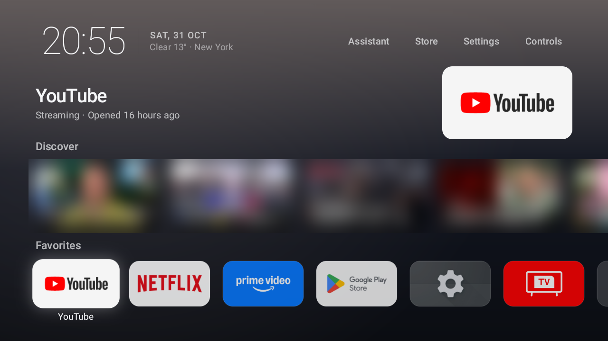 | 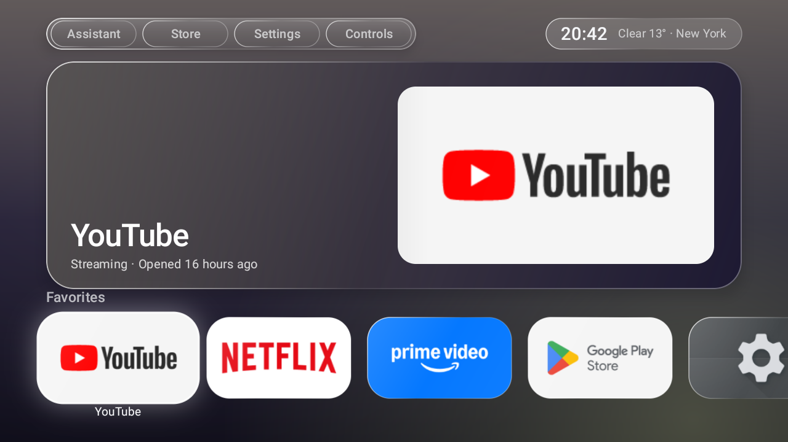 | 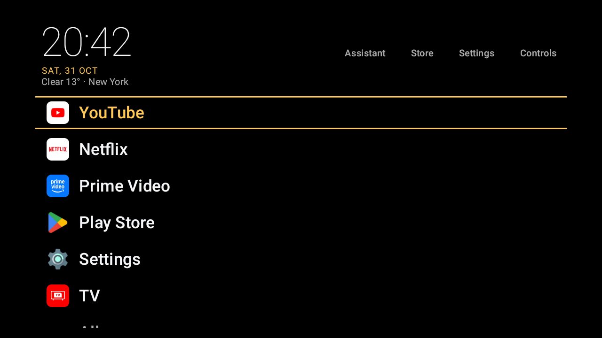 |
| 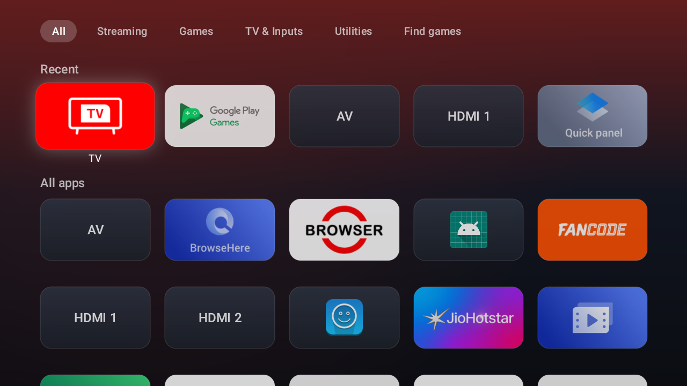 | 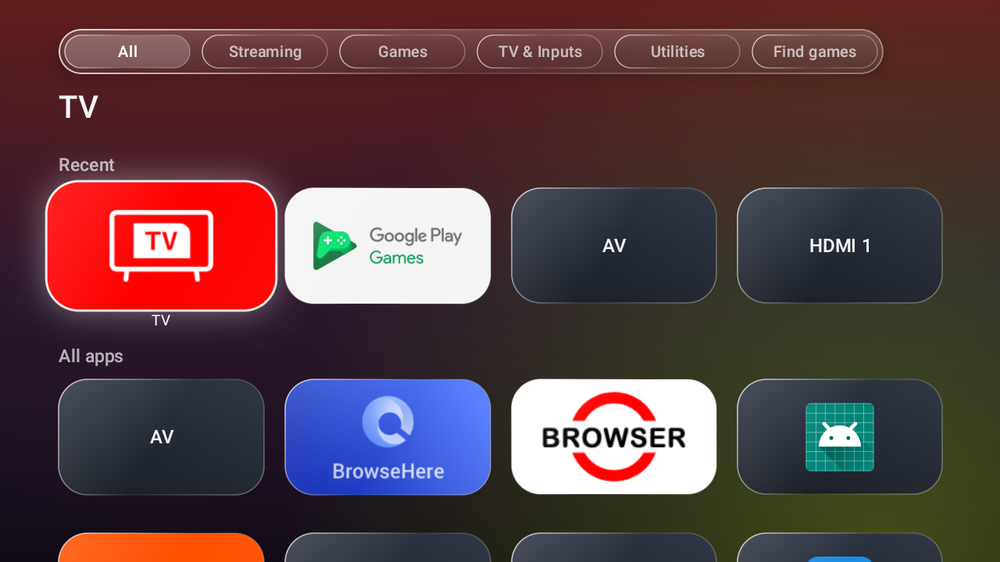 | 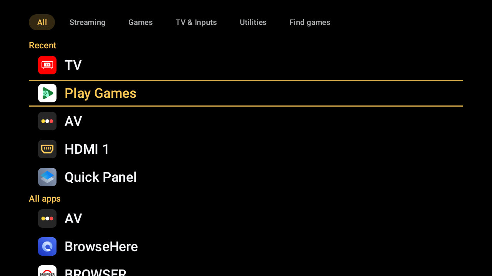 |

| Arcade | Arcade game (Mancap) | Retro Console |
|---|---|---|
| 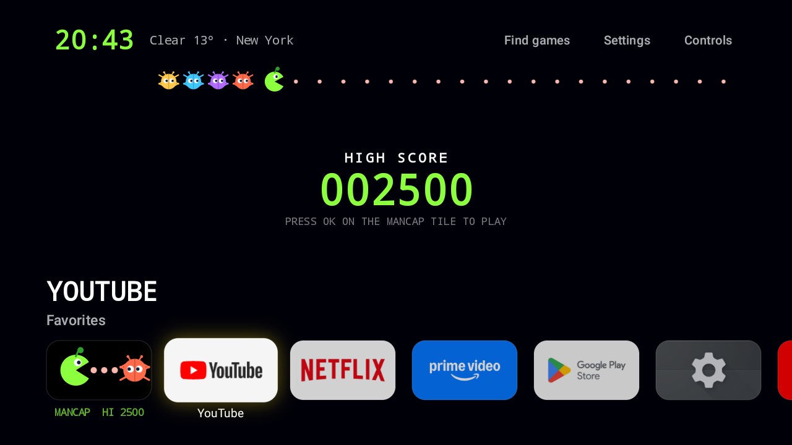 | 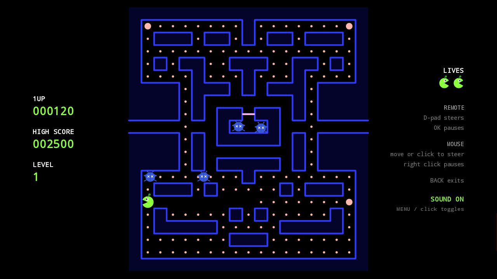 | 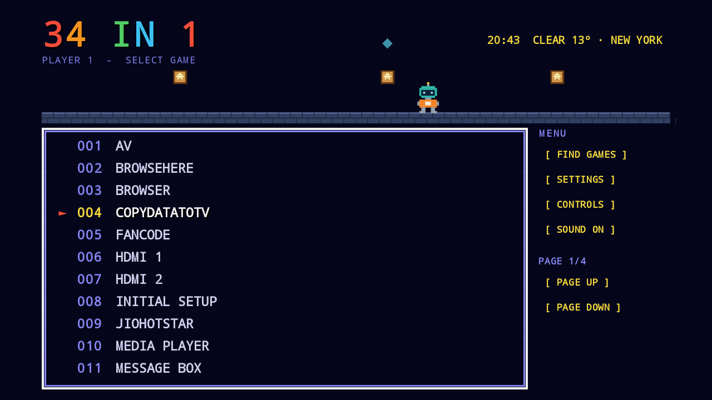 |

| Controls | Style picker | Weather |
|---|---|---|
| 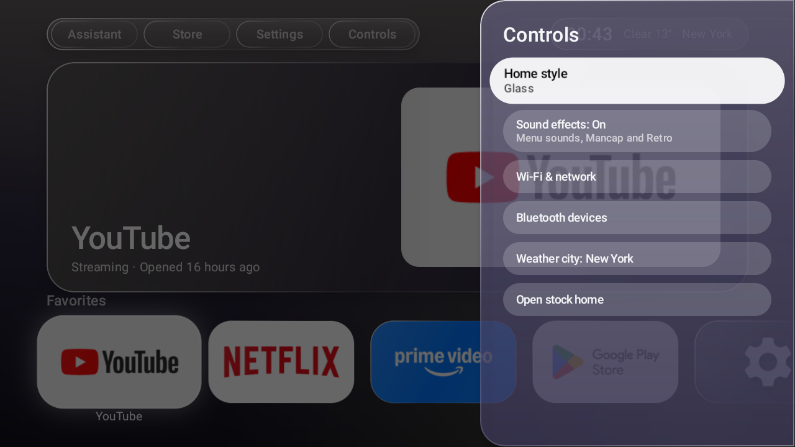 | 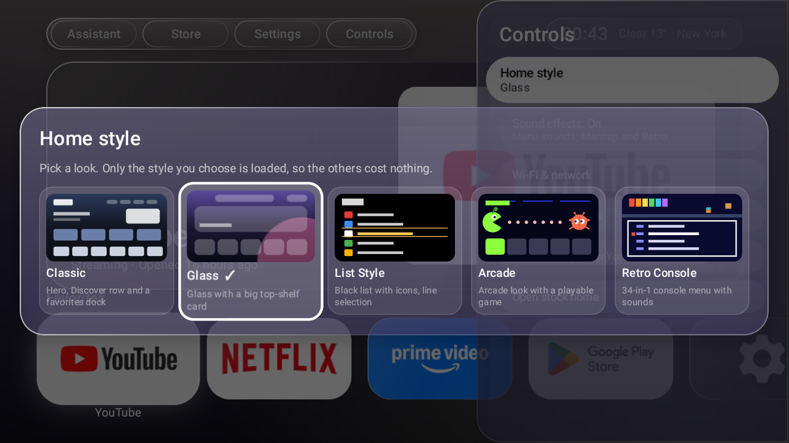 | 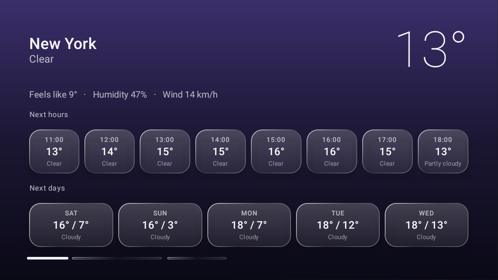 |

Screenshots show the weather for New York. App logos and banners belong to their owners.

## The five styles

Switch from **Controls > Home style**, which shows a preview of each. The choice is saved and survives restarts.

- **Classic:** large clock and weather, a hero for the focused app, a Discover row of trailers and sports highlights, and a Favorites dock.
- **Glass:** translucent glass capsules with bright rims over a vivid backdrop that follows the artwork, a big top-shelf card for the focused app, and one row of glass tiles.
- **List Style:** black screen, a text list with app icons (drawn icons for HDMI and AV inputs), and the selection shown as a line above and below the row.
- **Arcade:** an arcade look with a chomping strip and a playable game, **Mancap**, as the first tile. Remote or mouse, sound, and a saved high score.
- **Retro Console:** an "N in 1" game-cart menu where N is the number of apps, each a numbered "game", with a small robot, **Atario**, running along the top and a tick as the cursor moves. A side menu keeps Find games, Settings, Controls, Sound and paging one key press away.

Every style has its own colors (applied to every sheet, menu and button) and its own All Apps screen, and every style shows the weather. Only Classic loads Discover.

## Features

- **One top menu:** Assistant, Store, Settings and Controls (the two game styles use Find games, Settings and Controls). Accounts are left to the TV's own Settings.
- **All Apps:** opens on All with a Recent row on top; tabs for Streaming, Games, TV & Inputs and Utilities. **Find games** in the top bar opens Play Store's search for games.
- **Weather page:** click or press OK on the clock for full-screen weather. *Use current location* sets the city from this connection's IP (city-level, only when you press it); *Change city* types one.
- **Sounds:** each style has its own navigation sounds, synthesized in the app (no audio files). *Sound effects* in Controls switches them off.
- **Mouse:** hover focuses, left click opens, right click is a long press, the wheel scrolls rows.
- **Long-press OK on any tile:** add or remove a favorite, move it to another category, or open App info.

## Compatibility

**Tested:** one TCL Android TV, Android 11, 1280x720, remote and USB mouse. Nothing else has been tried, so treat the rest as expectations.

| Device | Expectation |
|---|---|
| Android TV OS 9+ (TCL, Sony, Philips, Hisense, Xiaomi, Nvidia Shield, most TV boxes) | Should install and run (`minSdk` 28, needs the `leanback` feature). Becoming the Home screen needs the steps below; some makers' stock launchers ignore the "default home" setting. |
| Google TV (Chromecast with Google TV and TVs running Google TV) | Installs and runs as an app. Whether it can replace Home depends on the firmware; recent builds may not allow it. |
| Fire TV | Not supported. Fire OS does not honor a third-party Home app without extra tooling. |
| Screens | Layouts are in dp and have only been seen at 720p; 1080p and 4K should scale but are unverified. |

Some features lean on this TV's quirks: there is no Sound shortcut (this TCL's Sound screen crashes when opened from outside Settings), and connecting paired Bluetooth devices uses hidden APIs that only work for apps targeting SDK 30.

## Install

You need the APK ([download](https://github.com/sidbha-del/TVWardrobe/releases/latest), or build it below) and a way to put it on the TV. The release APK is signed with the debug key, so it is for sideloading only.

**With a PC (adb):**

1. On the TV: Settings > Device Preferences > About, tap *Build* seven times. Then Developer options > enable *USB debugging* or *Network/ADB debugging*. Note the TV's IP address (Settings > Network).
2. On the PC, with Android's `platform-tools` (adb) installed:
   ```
   adb connect <tv-ip>:5555           # accept "Allow debugging?" on the TV
   adb install -r TVWardrobe-1.0.0.apk
   ```
3. It shows up as *TVWardrobe* in the TV's app list. Open it once.
4. Make it the Home screen (optional, see below).

**Without a PC:** put the APK on a USB drive, or fetch it with the *Downloader* app, and open it with a file manager on the TV (allow "Install unknown apps" for that app). It then runs as a normal app; making it the Home screen still needs adb or a TV that offers a Home-app choice.

The TV's IP address changes on many home networks. If `adb connect` times out, check the address again and that the TV is awake.

### Making it the Home screen

Try the gentle way first: press Home. If the TV offers a choice, pick *TVWardrobe* and "Always". Otherwise:

```
adb shell cmd package set-home-activity com.sidbh.tvlauncher/.MainActivity
```

On the TCL this tested on, that setting was ignored while the stock launcher was enabled, so the stock launcher also had to be disabled for the user. Only do this if the first step did not work, and keep the revert command handy; the package name differs on other brands (`com.google.android.tvlauncher` is the Google one):

```
adb shell pm disable-user --user 0 com.google.android.tvlauncher
```

To switch back:

```
adb shell pm enable com.google.android.tvlauncher
adb shell cmd package set-home-activity com.google.android.tvlauncher/.MainActivity
```

Without adb: Settings > Apps > See all apps > show system apps > the stock launcher > Enable. Settings stays reachable from TVWardrobe's own Settings button.

## Shortcuts from adb

```
adb shell am start -n com.sidbh.tvlauncher/.MainActivity --es style retro            # classic, glass, liststyle, arcade, retro
adb shell am start -n com.sidbh.tvlauncher/.MainActivity --es city "Your City"       # weather city
```

## Build

```
set JAVA_HOME=C:\Program Files\Android\Android Studio\jbr
gradlew assembleRelease      # app\build\outputs\apk\release\app-release.apk
gradlew testDebugUnitTest    # the Mancap game engine's tests
```

Kotlin and Jetpack Compose for TV. `targetSdk` is 30 on purpose: connecting paired Bluetooth devices needs hidden APIs that Android 11 only allows for apps targeting SDK 30 or lower. The Bluetooth connect path has not been tried on a real device; if it is blocked, the sheet says so.

## Legal and data

- The Retro and Arcade styles are original artwork in the spirit of old console menus and maze games: the game, its characters, the maze and the runner robot are drawn from scratch. Names such as "Mancap" and "Atario" are playful and carry no affiliation with any company.
- Weather comes from [Open-Meteo](https://open-meteo.com) (free for non-commercial use; attribution required). "Use current location" asks ipwho.is for a city-level location from your IP, only when you press it. Discover reads public YouTube channel feeds.
- Android TV, Google TV, Play Store and YouTube are trademarks of Google LLC; this project is not affiliated with or endorsed by Google or any TV maker.

## Layout

- `MainActivity.kt` - HOME activity; Menu key, Home press and adb extras.
- `LauncherState.kt` - what the screens read, plus every action. `LauncherPrefs.kt` stores settings.
- `AppRepository.kt` - lists apps, categorizes them, loads banners and icons.
- `ui/` - the five home styles (`HomeScreen.kt`, `HomeGlass.kt`, `HomeListStyle.kt`, `HomeArcade.kt`, `HomeRetro.kt`), All Apps, Controls, the style picker, tiles and theme.
- `ChompEngine.kt` - the Mancap game rules, with no Android dependency, so they are unit tested.
- `ToneBank.kt`, `UiSounds.kt`, `ChompSounds.kt`, `RetroSounds.kt` - synthesized sound effects.

## License

[Apache License 2.0](LICENSE).
